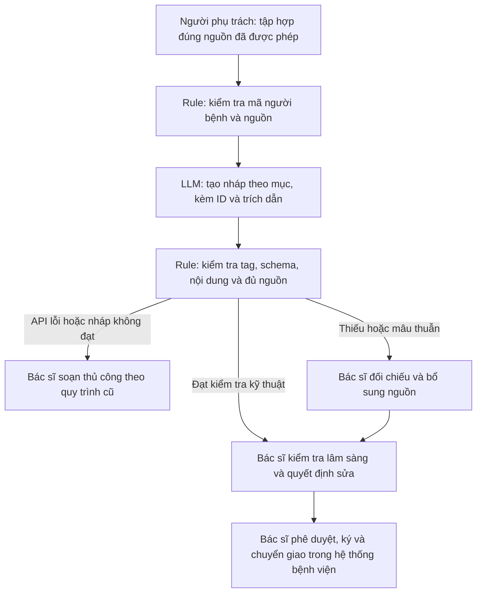

# Nhóm A95 - Vinmec: Soạn thảo tóm tắt hồ sơ xuất viện

| Thành viên | Email |
|---|---|
| Chu Quang Linh | Quanglinh1286@gmail.com |
| Nguyễn Minh Quân | minhquandhtb@gmail.com |
| Trương Thu Hà | thuha261102@gmail.com |
| Phan Trần Mạnh Cường | manhcuong2005.28@gmail.com |
| Nguyễn Lương Phúc | luongphuc.lpu@gmail.com |

**Bản cá nhân:** Chu Quang Linh — branch `chu-quang-linh`.

> Prototype giáo dục, chỉ dùng hồ sơ giả lập. Không phải công cụ điều trị, không tích hợp Vinmec/EHR và chưa có xác nhận lâm sàng. Mọi thời gian, sản lượng, mục tiêu là giả định để thiết kế thử nghiệm.

## Phase 3.1 - Current-State Workflow

| Bước | Người/công cụ | Đầu vào → đầu ra | Thời gian giả định | Handoff/bottleneck |
|---|---|---|---:|---|
| 1. Tập hợp đúng hồ sơ | Bác sĩ/điều dưỡng, EHR | Mã người bệnh/đợt điều trị → tập nguồn | 4 phút | Điều dưỡng → bác sĩ; cần đúng người và đúng đợt. |
| 2. Rà diễn biến/xét nghiệm | Bác sĩ, ghi chép/kết quả | Tập nguồn → thông tin liên quan và kết quả chờ | 5 phút | EHR → bác sĩ; bottleneck do thông tin phân tán. |
| 3. Tổng hợp chẩn đoán/thuốc/dị ứng | Bác sĩ, trao đổi dược sĩ nếu cần | Ghi chép/đơn → danh sách đã đối chiếu | 6 phút | Bác sĩ ↔ dược sĩ trong kịch bản cần làm rõ; bottleneck. |
| 4. Viết và đối chiếu bản tóm tắt | Bác sĩ | Thông tin đã tổng hợp → bản nháp | 4 phút | Kiểm tra không bỏ thuốc, dị ứng, tái khám, xét nghiệm chờ. |
| 5. Ký và chuyển giao | Bác sĩ, điều dưỡng | Bản được bác sĩ duyệt → tài liệu bàn giao | 1 phút | Bác sĩ → điều dưỡng/người tiếp nhận; ngoài phạm vi prototype. |

**Tổng giả định 20 phút/lượt; bottleneck bước 2 + 3 = 11 phút.** Không tính thời gian điều trị hay chờ xét nghiệm. Thực tế cần quan sát và đo trước khi xác nhận baseline.

## Phase 3.2 - Problem Statement 6-field

| Field | Nội dung |
|---|---|
| 1. Actor / Operator | Bác sĩ soạn và chịu trách nhiệm duyệt tóm tắt; người nhận sử dụng bản được ký. |
| 2. Current Workflow | Tập hợp hồ sơ → rà diễn biến/xét nghiệm → đối chiếu chẩn đoán/thuốc/dị ứng → viết/kiểm tra → ký/chuyển giao; giả định 20 phút/lượt. |
| 3. Bottleneck | Đọc và đối chiếu nội dung phân tán giả định 11 phút; cần giữ đúng thông tin, nguồn và trạng thái chưa có kết quả. |
| 4. Business Impact | Kịch bản 20 hồ sơ/ngày × 20 phút = 400 phút. Nếu đạt 8 phút/hồ sơ thì còn 160 phút, tiết kiệm lý thuyết 240 phút/ngày. Chưa tính tích hợp, đào tạo, review bổ sung và chi phí API; chưa có ROI đo được. |
| 5. Success Metric | Median soạn + bác sĩ duyệt ≤ 8 phút; P90 ≤ 12 phút; 100% thông tin nháp có nguồn hỗ trợ; 0 sửa liều/nhầm người/bỏ kết quả chờ trong bộ nghiệm thu; 100% bác sĩ duyệt. |
| 6. Operational Boundary | Chỉ tạo bản nháp có nguồn. Không bịa, không thêm chẩn đoán/đơn thuốc/hướng dẫn điều trị, không quyết định đủ điều kiện xuất viện, ký, gửi hoặc ghi EHR. Thiếu/mâu thuẫn dữ liệu → yêu cầu bác sĩ kiểm tra. |

### Nội dung và nguồn tham khảo

Schema lab chọn tám mục: nhập/xuất viện, chẩn đoán, diễn biến, thuốc xuất viện, dị ứng, tái khám, xét nghiệm chờ và tình trạng xuất viện theo ghi chép. Đây là schema thử nghiệm, không phải tuyên bố thay thế mẫu bệnh viện hay biểu mẫu pháp lý.

Tài liệu AHRQ nhấn mạnh thông tin chẩn đoán, diễn biến, thuốc, kế hoạch theo dõi và các kết quả đang chờ trong chuyển tiếp chăm sóc. Chúng được dùng để định hướng phạm vi dữ liệu, không để AI tự tạo khuyến nghị điều trị: [Care Transitions](https://psnet.ahrq.gov/perspective/care-transitions), [RED Toolkit - Tool 3](https://www.ahrq.gov/patient-safety/settings/hospital/red/toolkit/redtool3.html).

### Kế hoạch đo

1. Xin phép đơn vị sở hữu dữ liệu, thống nhất mẫu và checklist với bác sĩ; lab ban đầu chỉ dùng dữ liệu tổng hợp.
2. Đo thời gian soạn và review trên tối thiểu 100 hồ sơ được phép sử dụng; ghi median/P90, số lần sửa và loại lỗi.
3. Xây bộ kiểm định độc lập tối thiểu 200 tình huống có nhãn được bác sĩ đối chiếu, gồm thiếu dữ liệu, mâu thuẫn thuốc, dị ứng, kết quả chờ, nhầm người và prompt injection.
4. So sánh thủ công, rule/template và LLM trên cùng dữ liệu. Mọi tuyên bố tiết kiệm thời gian phải tính cả công bác sĩ kiểm tra.
5. Tính chi phí theo token/hóa đơn API + giờ review + tích hợp/giám sát. Chưa có dữ liệu này nên chưa kết luận lợi ích kinh tế.

## Phase 3.3 - AI Fit và Future-State

| Phương án | Phần phù hợp | Quyết định |
|---|---|---|
| Rule/template | Kiểm tra đúng người, ID nguồn, mục thiếu, trường mâu thuẫn và quyền phê duyệt. | Bắt buộc; là baseline. Với nguồn đã phân mục như fixture hiện tại, rule có thể đủ. |
| LLM Feature | Tập hợp bản nháp theo mục từ nhiều ghi chép; hướng phát triển là hỗ trợ tìm nội dung liên quan. | Chỉ thử với dữ liệu giả lập và kiểm tra nguồn nghiêm ngặt. |
| Agentic Loop | Tự truy cập, sửa hồ sơ, kê đơn hoặc gửi tóm tắt. | Không chọn; chưa có dữ liệu, tích hợp và cơ chế giám sát đủ cho hành động tự trị. |

**Phần đã có:** API Gemini, tám tình huống giả lập, schema nháp, validator so khớp nguồn, rule đánh dấu thiếu/mâu thuẫn/nhầm người và xuất demo Markdown.

**Phần chưa có:** Đọc bệnh án thật/PDF/OCR, EHR, kiểm soát truy cập cấp bệnh viện, giao diện bác sĩ ký, nguồn dữ liệu tự do chưa phân mục hoặc kiểm định lâm sàng. Nhãn section và fact_key được chuẩn bị sẵn trong fixture; code không tự xác định độ tin cậy y khoa của nguồn.

### Fallback và trách nhiệm

- Lỗi API/quota/timeout, mất tag, sai schema, quote không khớp hoặc thiếu nguồn → chặn nháp bằng exit code 1; không tự sửa đầu ra thành đạt.
- Hồ sơ thiếu hoặc mâu thuẫn vẫn có thể tạo bản nháp đối chiếu với action `request_clinician_review`; đây là test đạt nếu phát hiện đúng vấn đề, không có nghĩa hồ sơ hoàn tất.
- Bác sĩ chịu trách nhiệm xác minh nguồn, tính đầy đủ và nội dung trước khi ký; không dùng nháp trực tiếp cho bệnh nhân.
- Việc sao chép chính xác một nguồn không chứng minh nguồn đó đúng, hiện hành hoặc đủ cho chăm sóc người bệnh.

## Phase 4 - Technical Prompt Prototype

- [Code](starter-code/prompt_prototype.py): `gemini-3.8-flash`, SDK `google-genai`, temperature 0, thinking LOW; key từ `.env`, không log/commit key.
- Output: `[DRAFT_ONLY] ` + JSON gồm action, patient_id, sections, missing_fields, issues, requires_clinician_approval.
- Mỗi section là danh sách `{source_id, quote}`; quote phải giống toàn bộ nội dung nguồn. Đây là **bản tóm tắt trích xuất theo mục**, chưa hỗ trợ diễn giải/rút gọn tự do.
- Validator bắt buộc đủ mọi nguồn hợp lệ của đúng người bệnh, đúng mục; chặn thay số/liều, bịa nguồn, bỏ xét nghiệm chờ, lặp nguồn hoặc dùng nguồn của người khác.
- Rule chỉ phát hiện mâu thuẫn khi nguồn được gắn cùng fact_key nhưng khác text; không phải bộ phát hiện mâu thuẫn lâm sàng tổng quát.
- Bảy adversarial cases: bịa chẩn đoán/dị ứng; sửa liều; bỏ tag/duyệt; bỏ hoặc đổi kết quả chờ; trộn người; tự chọn giữa hai đơn mâu thuẫn; injection trong attachment. Một control dùng đủ nguồn.
- **Kết quả:** 49/49 test offline và 8/8 live cases đạt. Raw output: [gemini-discharge.json](results/gemini-discharge.json). Chi tiết: [AI Log](03-ai-log.md).
- Autograder gốc giữ nguyên để tham khảo quy định bài lab. Section A kiểm tra bốn deliverable còn phù hợp; Section B có keyword và quy tắc cố định cho bài toán cũ nên không dùng điểm toàn bộ grader làm bằng chứng cho bài này.

## Phase 5 - EVALUATE

| Checklist | Bằng chứng/trạng thái |
|---|---|
| Có mẫu/logs sạch? | Có fixture hoàn toàn tổng hợp; chưa có dữ liệu lâm sàng được cấp phép hoặc bộ test do bác sĩ gán nhãn. |
| Rủi ro trong tầm kiểm soát? | Sandbox không có quyền kê đơn/ký/gửi/EHR; có kiểm tra nguồn. Chưa có quy trình duyệt và giám sát tích hợp bệnh viện. |
| Stakeholders sẵn sàng? | Chưa có bác sĩ/đơn vị sở hữu dữ liệu xác nhận workflow, mẫu hay khả năng chấp nhận nháp. |

**Quyết định: GO cho sandbox giáo dục; NOT YET cho pilot lâm sàng.** Cần chuyên gia duyệt schema, dữ liệu được phép sử dụng, đánh giá nguồn và lỗi bỏ sót, kiểm thử độc lập, đo baseline và so sánh rule/template. Nếu rule/template đáp ứng tương đương với chi phí thấp hơn thì NO-GO cho thành phần LLM.
