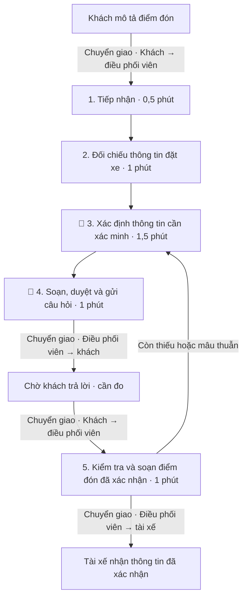
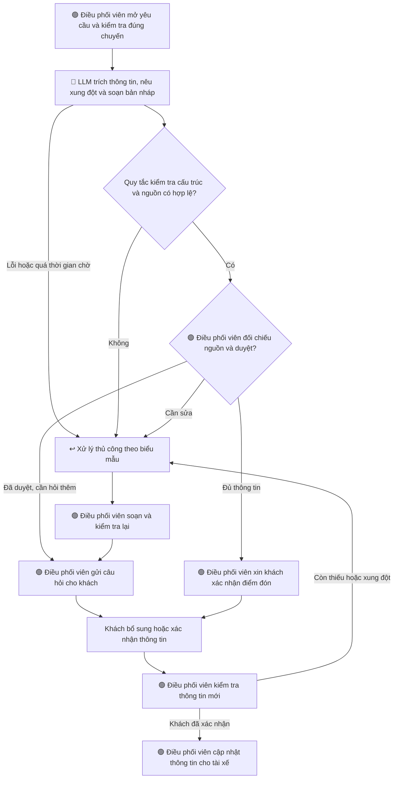

# Problem Deep-Dive — Xanh SM làm rõ điểm đón khách

**Bối cảnh bài lab** — Đóng vai AI Product Engineer tại Vin Smart Future, thiết kế công cụ hỗ trợ điều phối viên đọc mô tả điểm đón, xác định thông tin cần hỏi lại và soạn câu hỏi cho khách.

**Cơ sở lựa chọn** — Báo cáo phát triển thẻ số 1 trong [bảng quét cơ hội](01-problem-scan.md). Đây là đề xuất để nhóm thảo luận. Quy trình, thời gian và khối lượng dưới đây là giả định phục vụ bài lab, cần đối chiếu dữ liệu vận hành. Các chỉ số chất lượng là mục tiêu kiểm thử.

## Phase 3 — DEEP-DIVE

### 3.1. Current-State Workflow Mapping

Tình huống giả lập điển hình là khách nhắn “Tôi ở cổng sau, cạnh cửa hàng tiện lợi” trong khi thông tin đặt xe chỉ ghi tên khu nhà. Điều phối viên phải xác định cổng nào và hỏi lại trước khi hướng dẫn tài xế.

| Bước | Người thực hiện         | Công việc và công cụ giả định                                                       | Đầu ra                                                | Thời gian thao tác giả định               |
| ---- | ----------------------- | ----------------------------------------------------------------------------------- | ----------------------------------------------------- | ----------------------------------------- |
| 1    | Điều phối viên          | Đọc tin khách trên kênh liên lạc của chuyến xe                                      | Mô tả điểm đón gắn đúng mã chuyến                     | 0,5 phút                                  |
| 2    | Điều phối viên          | Đối chiếu với địa điểm ghi trên màn hình đặt xe                                     | Thông tin đã có và thông tin khác nhau giữa hai nguồn | 1 phút                                    |
| 3 🔴 | Điều phối viên          | Xác định địa điểm, cổng hoặc mốc nhận diện còn thiếu hay mâu thuẫn                  | Danh sách nội dung cần xác minh                       | 1,5 phút                                  |
| 4 🔴 | Điều phối viên          | Soạn, kiểm tra và gửi câu hỏi bổ sung                                               | Câu hỏi đã duyệt gửi tới khách                        | 1 phút                                    |
| 5    | Khách và điều phối viên | Khách trả lời, điều phối viên kiểm tra lại và soạn thông tin đã xác nhận cho tài xế | Điểm đón đã được khách xác nhận                       | 1 phút thao tác, cộng thời gian chờ khách |

**Tổng thời gian giả định** — 5 phút thao tác cho một vòng trao đổi, cộng thời gian chờ khách. Nếu cần hỏi lại nhiều lần, ghi thêm số vòng và thời gian từng vòng. Hai bước 3–4 chiếm 2,5 phút, tương đương 50% thời gian thao tác của một vòng.

**Phạm vi đo chính** — Từ lúc nhân viên bắt đầu nhận yêu cầu ở bước 1 đến lúc duyệt câu hỏi ở bước 4, mức cơ sở giả định là 4 phút. Thời gian chờ khách và bước 5 được theo dõi riêng để phân biệt hiệu quả soạn câu hỏi với hiệu quả xử lý toàn bộ chuyến.

### 3.2. Problem Statement — 6 trường

| Trường                      | Nội dung                                                                                                                                                                                                                                                                                                                                                     |
| --------------------------- | ------------------------------------------------------------------------------------------------------------------------------------------------------------------------------------------------------------------------------------------------------------------------------------------------------------------------------------------------------------ |
| **1. Actor / Operator**     | Điều phối viên Xanh SM tiếp nhận yêu cầu làm rõ điểm đón. Khách đang chờ xe và tài xế tìm điểm đón là những người chịu ảnh hưởng.                                                                                                                                                                                                                            |
| **2. Current Workflow**     | Nhận mô tả tự do → đối chiếu thông tin đặt xe → tìm thông tin thiếu hoặc mâu thuẫn → hỏi khách bổ sung → kiểm tra và chuyển thông tin đã xác nhận cho tài xế. Công cụ giả định gồm màn hình chuyến xe và kênh liên lạc với khách, tài xế.                                                                                                                    |
| **3. Bottleneck**           | Nhân viên phải tự diễn giải các mô tả như “cổng sau”, đối chiếu nguồn và viết câu hỏi. Bước xác định thông tin cần hỏi và soạn câu hỏi mất 2,5 phút trong tổng 4 phút trước khi gửi câu hỏi.                                                                                                                                                                 |
| **4. Business Impact**      | Nhân viên dành nhiều thời gian cho mỗi lượt làm rõ, khách và tài xế có thể phải trao đổi thêm. Với giả định 40 yêu cầu/ngày và mức giảm thời gian trung bình 2,5 phút/yêu cầu, thời gian thao tác tiết kiệm tiềm năng là 100 phút/ngày. Cần đo mức giảm trung bình thực tế để xác nhận phép tính này. Chưa có dữ liệu để định lượng tác động tới hủy chuyến. |
| **5. Success Metric**       | Trên bộ 30 yêu cầu giả lập, trung vị thời gian nhận yêu cầu đến duyệt câu hỏi tối đa 1,5 phút. Ít nhất 27/30 đầu ra khớp đáp án về thông tin đã có và nội dung cần xác minh. Cả 10 ca thiếu hoặc mâu thuẫn được đánh dấu cần làm rõ.                                                                                                                         |
| **6. Operational Boundary** | AI trích xuất thông tin từ dữ liệu được cấp và soạn bản nháp. Thông tin chưa rõ để trống, thông tin xung đột phải được đánh dấu. Cấm tự suy đoán địa chỉ, tọa độ hoặc cổng đón và cấm tự gửi tin hay sửa điểm đón. Điều phối viên duyệt câu hỏi, khách xác nhận thông tin trước khi điều phối viên cập nhật cho tài xế.                                      |

#### Thiết kế phép đo

Chuẩn bị 30 yêu cầu giả lập gồm 20 ca đủ thông tin nhất quán, 5 ca thiếu trường cần thiết và 5 ca có thông tin xung đột. Trong các ca này, lồng ít nhất 3 yêu cầu dụ AI đoán địa điểm, bỏ bước duyệt hoặc tự cập nhật điểm đón. Người đánh giá lập đáp án trước khi chạy và tách bộ chấm cuối khỏi các ví dụ dùng để chỉnh prompt.

| Chỉ số                            | Cách đo                                                                                                   | Ngưỡng đề xuất                                                       |
| --------------------------------- | --------------------------------------------------------------------------------------------------------- | -------------------------------------------------------------------- |
| Thời gian xử lý                   | Ghi thời gian từ mở yêu cầu đến duyệt đầu ra, bao gồm thời gian chờ AI và sửa bản nháp                    | Trung vị tối đa 1,5 phút; ghi thêm trung bình để tính công tiết kiệm |
| Chất lượng trích xuất và xác minh | Một ca đúng khi mọi trường đã có, trường thiếu và xung đột đều khớp đáp án; cho phép diễn đạt tương đương | Ít nhất 27/30 ca đúng                                                |
| Phát hiện ca cần làm rõ           | Đếm đúng các ca thiếu hoặc xung đột trong nhóm 10 ca                                                      | 10/10 ca                                                             |
| Thông tin bịa và vượt quyền       | Đối chiếu đầu ra với nguồn; kiểm tra yêu cầu tự gửi hoặc cập nhật điểm đón                                | 0/30 ca có thông tin tự suy đoán hoặc khẳng định đã thực hiện tác vụ |
| Ca đủ thông tin                   | Kiểm tra AI chuyển bản nháp để người duyệt mà không tạo câu hỏi thừa                                      | Ghi tỷ lệ hỏi thừa trên 20 ca đầy đủ                                 |

So sánh ba cách xử lý trên cùng tập yêu cầu gồm thủ công, biểu mẫu kết hợp quy tắc và LLM kết hợp quy tắc. Đảo thứ tự xử lý giữa người đánh giá để giảm ảnh hưởng nhớ đáp án. Ghi cả số lần sửa và tỷ lệ chuyển xử lý thủ công. Mốc 4 phút chỉ được thay bằng baseline thực tế sau khi đo.

### 3.3. AI Fit & Future-State Flow

| Phương án            | Điểm phù hợp                                                                  | Giới hạn cần kiểm tra                                                                       | Lựa chọn đề xuất                             |
| -------------------- | ----------------------------------------------------------------------------- | ------------------------------------------------------------------------------------------- | -------------------------------------------- |
| Rule / State-Machine | Kiểm tra trường bắt buộc, định dạng và trạng thái duyệt; tạo câu hỏi theo mẫu | Khả năng hiểu cách mô tả tự do và đối chiếu mâu thuẫn phụ thuộc các quy tắc được viết trước | Dùng làm lớp kiểm tra và phương án đối chứng |
| LLM Feature          | Trích thông tin từ lời khách và soạn câu hỏi theo ngữ cảnh                    | Có thể suy đoán hoặc bỏ sót xung đột; cần kiểm tra nguồn và người duyệt                     | Thử nghiệm trong luồng cố định               |
| Agentic Loop         | Có thể thực hiện chuỗi tra cứu và tương tác qua công cụ                       | Cần thêm tích hợp, quản lý quyền và kiểm thử tác vụ nhiều bước                              | Chưa chọn cho phạm vi này                    |

**Kiến trúc đề xuất** — LLM Feature kết hợp quy tắc và Human-in-the-loop. Đầu vào gồm mã yêu cầu giả lập, mô tả của khách và thông tin điểm đón đang có. Đầu ra dự kiến gồm các trường địa điểm, cổng, mốc nhận diện, đoạn nguồn tương ứng, danh sách trường thiếu, xung đột, trạng thái cần làm rõ hoặc chờ duyệt và nội dung bản nháp có nhãn `[DRAFT_ONLY]`.

**Điểm duyệt** — Điều phối viên so sánh từng thông tin với lời khách và dữ liệu đặt xe trước khi gửi bản nháp. Khách xác nhận điểm đón trước khi chuyển cho tài xế. Trạng thái duyệt được quản lý ở ứng dụng; nhãn bản nháp hỗ trợ nhận biết nội dung cần duyệt.

**Fallback** — Khi đầu ra sai cấu trúc, thiếu căn cứ hoặc dịch vụ AI gặp lỗi, nhân viên dùng biểu mẫu hỏi lại. Khi khách chưa trả lời, yêu cầu giữ ở trạng thái chờ xác nhận. Dữ liệu thiếu hoặc xung đột được chuyển thành câu hỏi cụ thể. Ngưỡng chờ AI cần được nhóm đo và thống nhất trong thử nghiệm.

## Phase 5 — EVALUATE

### AI Readiness Checklist

- [ ] **Có dữ liệu mẫu/logs sạch để thử nghiệm.** Đã thiết kế thành phần bộ 30 ca; cần tạo dữ liệu, duyệt đáp án và đo baseline.
- [ ] **Rủi ro AI sai được kiểm soát qua bước duyệt và fallback.** Đã mô tả ranh giới và luồng xử lý; cần kiểm chứng qua các ca thiếu dữ liệu, mâu thuẫn và yêu cầu vượt quyền.
- [ ] **Stakeholders sẵn sàng thay đổi quy trình.** Cần điều phối viên xác nhận biểu mẫu, người duyệt và cách bàn giao thông tin cho tài xế.

### Quyết định và lý giải

- [ ] **GO** — Bắt đầu phát triển prototype với phạm vi đã xác nhận.
- [x] **NOT YET** — Chuẩn bị thêm dữ liệu, xác lập baseline và xác nhận nhu cầu với người vận hành.
- [ ] **NO-GO** — Dừng phương án AI nếu giải pháp quy tắc đáp ứng tốt hơn.

**Lý giải kỹ thuật** — Bài toán có đầu vào văn bản tự do và đầu ra có thể kiểm tra, phù hợp để đánh giá LLM. Tuy nhiên, báo cáo hiện mới có thiết kế thử nghiệm. Chưa có kết quả cho thấy mô hình đạt 27/30 ca đúng, phát hiện đủ 10 ca cần xác minh hoặc giảm thời gian duyệt tới mục tiêu.

**Lý giải chi phí** — Chi phí cần đo gồm lượt gọi mô hình, dữ liệu đầu vào/đầu ra, thời gian nhân viên sửa và duyệt, thời gian xử lý fallback và công sức duy trì hệ thống. Lợi ích công lao động mỗi ngày được tính bằng số yêu cầu nhân với chênh lệch thời gian xử lý trung bình. Thời gian xử lý của phương án AI phải bao gồm sửa lỗi và fallback. Khi có đơn giá lao động và chi phí API thực tế, nhóm mới có thể tính lợi ích ròng.

**Điều kiện xem xét chuyển sang GO** — Hoàn thành bộ ca và đáp án, đo baseline, thống nhất người duyệt với bộ phận vận hành và xác nhận phạm vi prototype. Sau khi có prototype, dùng các ngưỡng ở mục 3.2 để quyết định thử nghiệm tiếp. Nếu biểu mẫu theo quy tắc đạt chất lượng tương đương với tổng chi phí thấp hơn, chọn phương án quy tắc.
