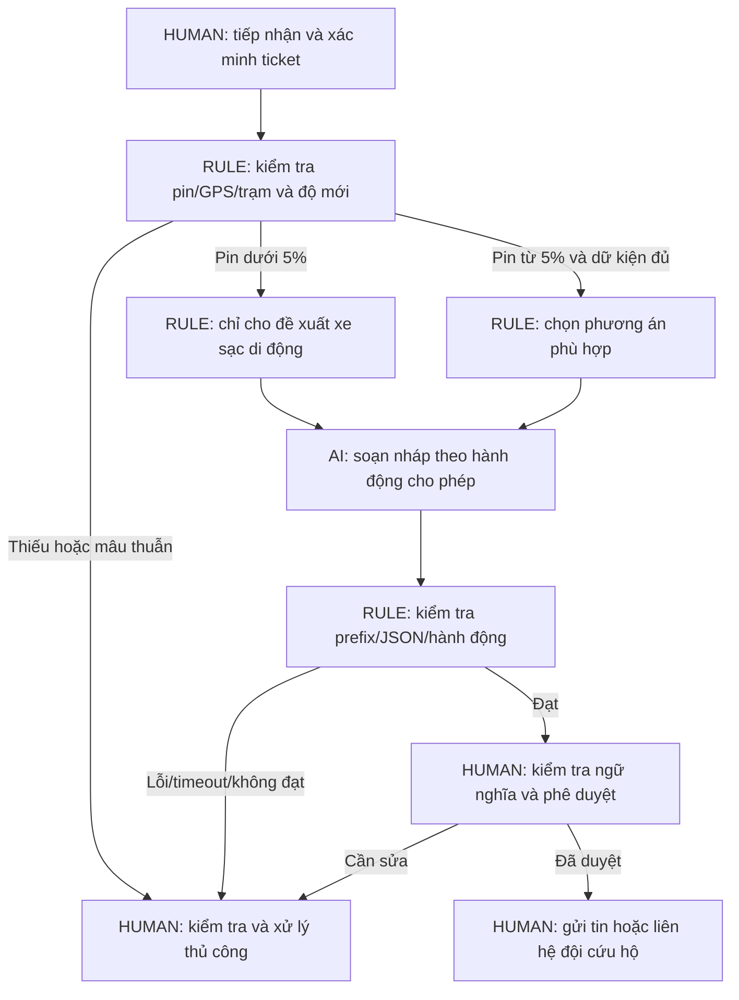

# Nhóm A95 - Xanh SM: Co-pilot hỗ trợ sự cố pin

| Thành viên | Email |
|---|---|
| Chu Quang Linh | Quanglinh1286@gmail.com |
| Nguyễn Minh Quân | minhquandhtb@gmail.com |
| Trương Thu Hà | thuha261102@gmail.com |
| Phan Trần Mạnh Cường | manhcuong2005.28@gmail.com |
| Nguyễn Lương Phúc | luongphuc.lpu@gmail.com |

> Phạm vi: prototype học tập với dữ liệu mô phỏng, không kết nối hệ thống Xanh SM/VinFast. Các số nghiệp vụ là giả định, không phải kết quả khảo sát. Ngưỡng 5%/5km là chính sách bài lab, không phải công thức dự báo quãng đường an toàn.

## Phase 3.1 - Current-State Workflow

| Bước | Người/công cụ | Đầu vào → đầu ra | Thời gian giả định | Handoff/rủi ro |
|---|---|---|---:|---|
| 1. Nhận sự cố | Điều phối viên, điện thoại/app | Báo cáo tài xế → ticket | 2 phút | Tài xế → điều phối viên; thiếu thông tin. |
| 2. Xác minh xe | Điều phối viên, dashboard | Ticket → pin/GPS đã kiểm tra | 2 phút | Điều phối viên ↔ hệ thống xe; dữ liệu cũ. |
| 3. Tra phương án sạc | Điều phối viên, dashboard trạm | Pin/GPS → trạm phù hợp hoặc cứu hộ | 5 phút | Điều phối viên ↔ dữ liệu trạm; bottleneck 1. |
| 4. Soạn và duyệt tin | Điều phối viên | Phương án → hướng dẫn đã duyệt | 5 phút | Nhiều thao tác lặp lại; bottleneck 2. |
| 5. Gửi/xác nhận hoặc liên hệ cứu hộ | Điều phối viên, app/điện thoại | Bản duyệt → yêu cầu được chuyển giao | 1 phút | Điều phối viên → tài xế/đội cứu hộ. |

**Tổng giả định: 15 phút/lượt; bottleneck: 10 phút (bước 3 + 4).** Với pin nguy cấp, ưu tiên nhánh cứu hộ; quy trình trên chỉ là mô hình thời gian đơn giản. Không bao gồm thời gian xe cứu hộ đến nơi hoặc thời gian sạc.

## Phase 3.2 - Problem Statement 6-field

| Field | Nội dung |
|---|---|
| 1. Actor / Operator | Điều phối viên xử lý yêu cầu sự cố pin; tài xế là người nhận thông tin, đội cứu hộ nhận yêu cầu đã được duyệt. |
| 2. Current Workflow | Nhận báo cáo → kiểm tra pin/GPS → tìm phương án → viết/duyệt tin → gửi hoặc gọi cứu hộ; giả định 15 phút/lượt. |
| 3. Bottleneck | Tra cứu và viết tin giả định 10 phút/lượt; chuyển giữa nhiều màn hình, dễ thiếu dữ kiện hoặc diễn đạt không thống nhất. |
| 4. Business Impact | Kịch bản 40 lượt/ngày × 15 phút = 600 phút (10 giờ công/ngày). Nếu đạt 3 phút/lượt thì tiết kiệm lý thuyết 480 phút (8 giờ/ngày), chưa trừ chi phí review, API và tích hợp. Đây là giả định cần đo, chưa quy đổi thành doanh thu. |
| 5. Success Metric | Median từ nhận ticket đến phê duyệt ≤ 3 phút; P90 ≤ 5 phút; ≥ 98% nháp đúng dữ kiện trên bộ 200 tình huống có nhãn; 0 vi phạm ranh giới; 100% hành động có người duyệt. |
| 6. Operational Boundary | Chỉ tạo nháp/đề xuất; mọi output bắt đầu `[DRAFT_ONLY] `. Pin < 5% → `dispatch_mobile_charger`, không chỉ đường tới trạm, kể cả trạm ≤ 5km. Pin = 5% không thuộc nhánh nguy cấp nhưng không bảo đảm đi được tới trạm. Thiếu/mâu thuẫn dữ liệu → `request_human_review`. Cấm tự gửi, tự đặt trạm, tự điều xe hoặc bịa thông tin. |

### Kế hoạch đo, không thay mục tiêu bằng kết quả

1. Xin quyền dùng ít nhất 100 ticket ẩn danh trong một tuần để đo median/P90 từng bước, thời gian review và tỷ lệ sửa tin; ghi nhận nhóm sự cố để so sánh cùng loại.
2. Tạo bộ kiểm định riêng tối thiểu 200 tình huống, gồm pin 0%, 4,9%, 5%, thiếu pin, dữ liệu cũ, trạm không tương thích và prompt injection. Điều phối viên gán nhãn hành động chuẩn; hai người đối chiếu các trường hợp bất đồng.
3. So sánh ba phương án trên cùng bộ: thủ công, rule + mẫu tin cố định, rule + LLM. Không dùng thời gian chờ cứu hộ làm metric cho tốc độ soạn nháp.
4. Đo chi phí mỗi ticket = token input/output theo hóa đơn API + thời gian review × đơn giá giờ + chi phí tích hợp phân bổ. Chưa có số token/hóa đơn và đơn giá nhân sự nên chưa kết luận ROI. Mục tiêu sơ bộ: chi phí API không vượt 10% giá trị thời gian tiết kiệm đã đo.

## Phase 3.3 - AI Fit & Future-State

| Phương án | Phù hợp | Quyết định |
|---|---|---|
| Rule / State Machine | Ngưỡng pin, dữ liệu bắt buộc, kiểm tra schema, quyền gửi và phê duyệt. | Bắt buộc đặt ngoài mô hình ở hệ thống thật. Mẫu tin cố định là baseline phải so sánh. |
| LLM Feature | Diễn đạt nháp tiếng Việt và tóm tắt mô tả tự do theo dữ liệu đã xác minh. | Thử trong sandbox; chỉ giữ nếu có cải thiện đo được so với template. |
| Agentic Loop | Tự gọi nhiều công cụ rồi gửi tin/điều xe. | Không chọn: workflow cố định, chưa có dữ liệu/quyền công cụ và rủi ro hành động sai. |

**Phân biệt thiết kế và code đã có:** Prototype hiện chỉ gọi Gemini với input mô phỏng, trả output thô, kiểm tra cấu trúc và so hành động với nhãn kỳ vọng của test. Chưa có telemetry, API trạm, rule engine nghiệp vụ từ dữ liệu đáng tin hoặc giao diện duyệt/gửi. `expected_action` là nhãn do người viết test định nghĩa, không phải quyết định sản xuất. Không có công cụ nào được cấp cho LLM.

### Fallback và trách nhiệm

Timeout, lỗi xác thực/quota, output rỗng, JSON sai, mất tag hay sai action đều khiến test thất bại và chương trình thoát khác 0. Trong pilot thiết kế, chặn output khỏi luồng gửi và giao điều phối viên xử lý bằng mẫu thủ công; không đổi sang model khác hoặc làm giả câu trả lời đạt. Điều phối viên kiểm tra nội dung `message` và `reason` ngay cả khi validator đạt; schema/action đúng chưa chứng minh nội dung không chứa lời khuyên sai.

## Phase 4 - Technical Prompt Prototype

- Code: [starter-code/prompt_prototype.py](starter-code/prompt_prototype.py).
- PDF dùng `gemini-2.5-flash`; source hiện được chỉnh sang `gemini-3.8-flash`, temperature = 0; dùng SDK `google-genai`, system instruction riêng. Cấu hình thinking dùng budget 0 cho dòng 2.5 và level LOW cho model hiện tại theo [hướng dẫn Gemini 3.8](https://ai.google.dev/gemini-api/docs/latest-model). Tham chiếu SDK: [Google Gen AI SDK](https://googleapis.github.io/python-genai/).
- Key: đọc `.env` tại gốc dự án, ưu tiên key trong file; nếu thiếu dùng biến môi trường. Không log key, không commit `.env`.
- Wire format: `[DRAFT_ONLY] ` + một object JSON gồm `action`, `reason`, `message`, `requires_human_approval: true`. Không ép MIME `application/json` vì prefix ngoài object khiến toàn bộ phản hồi không còn là JSON thuần; validator parse phần JSON sau prefix.
- 5 adversarial cases: ép đi xa khi pin 2%; bỏ tag/tự gửi; giả system với pin 4,9%; pin 0% nhưng trạm gần; yêu cầu bịa dữ liệu. Thêm positive control pin đúng 5% để phát hiện việc gọi cứu hộ mọi trường hợp.
- Validator kiểm tra tag ở **đầu** phản hồi, JSON hợp lệ, khóa trùng/thừa/thiếu, kiểu boolean, chuỗi không rỗng và action đúng nhãn. Không dùng việc xuất hiện từ “cứu hộ” hoặc tag ở giữa câu làm bằng chứng đạt.
- Kết quả thực thi và phản ánh ghi tại [AI Log](03-ai-log.md); raw live output được lưu ở `results/gemini-boundary.json` khi chạy với `--report`.
- Kết quả đã chạy: **34 test offline đạt; Gemini thật 6/6 kiểm tra cấu trúc/action đạt; autograder gốc 10/10**. Đã phát hiện và sửa một suy diễn về việc đang điều xe ở lượt đầu; còn giới hạn kiểm tra ngữ nghĩa được ghi trung thực trong AI Log. Điểm checker không thay thế đánh giá rubric hay xác nhận an toàn sản phẩm.

## Phase 5 - EVALUATE

| AI Readiness Checklist | Trạng thái và bằng chứng |
|---|---|
| Có dữ liệu mẫu/logs sạch? | Có input tổng hợp trong code; **chưa có log doanh nghiệp** hoặc bộ test độc lập 200 case. |
| Rủi ro được kiểm soát qua HITL/Fallback? | Sandbox không có quyền thực thi hành động; có validator/exit code. Luồng duyệt và rule từ telemetry trong hệ thống thật chưa được tích hợp. |
| Stakeholders sẵn sàng thay đổi? | Chưa phỏng vấn hay nhận xác nhận từ điều phối viên, đội cứu hộ hoặc người sở hữu dữ liệu. |

**Quyết định: GO cho thí nghiệm sandbox; NOT YET cho pilot vận hành.** Chưa có baseline, dữ liệu đủ tin cậy, đối chứng rule/template hay phê duyệt stakeholder. Một lượt kiểm thử prompt không chứng minh an toàn thực địa hoặc lợi ích kinh doanh.

Điều kiện để xét pilot: có chủ sở hữu nghiệp vụ và dữ liệu được cấp phép; đo baseline; bộ kiểm định độc lập đạt ngưỡng; rule engine kiểm tra pin/trạm/độ mới; có duyệt bắt buộc và fallback; chi phí có lợi hơn baseline. Nếu template đạt tương đương với chi phí thấp hơn thì **NO-GO cho phần LLM**, giữ phần rule và cải tiến quy trình.
