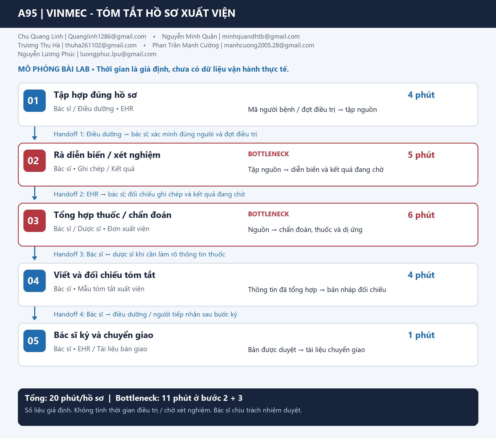

# A95 — Deep-Dive nhóm: Soạn thảo tóm tắt hồ sơ xuất viện

| Thành viên | Email | Branch cá nhân |
|---|---|---|
| Chu Quang Linh | Quanglinh1286@gmail.com | `chu-quang-linh` |
| Nguyễn Minh Quân | minhquandhtb@gmail.com | `NguyenMinhQuan` |
| Trương Thu Hà | thuha261102@gmail.com | `TruongThuHa` |
| Phan Trần Mạnh Cường | manhcuong2005.28@gmail.com | `manhcuong` |
| Nguyễn Lương Phúc | luongphuc.lpu@gmail.com | `phucluo` |

**Phạm vi:** scoping và sandbox giáo dục cho Vinmec; không phải công cụ điều trị hoặc tài liệu được phép phát hành cho bệnh nhân. Các branch được review theo commit cố định trong [05-group-review.md](05-group-review.md).

**Quy ước bằng chứng:** **GĐ** = giả định/mục tiêu; **KT** = kết quả kỹ thuật có artifact; **NG** = nguồn công khai đã đối chiếu; **TV** = tác giả branch tự thuật, chưa có raw log để tái xác minh. Không chuyển TV/GĐ thành KT.

## 1. Kết luận điều hành

Nhóm chọn **Discharge Summary** vì có hai bản phát triển cùng đề tài, có thể kiểm thử rõ việc giữ nguyên nguồn, đúng người bệnh và bác sĩ duyệt. Đối chứng mới cho thấy **template 8/8, Gemini đã lưu 8/8** trên cùng fixture có nhãn sẵn. Vì vậy chưa chứng minh cần LLM cho dữ liệu đã có cấu trúc.

**Quyết định chính: NOT YET cho triển khai LLM vào nghiệp vụ.** Định hướng: rule/template xử lý dữ kiện có cấu trúc; chỉ tiếp tục thử LLM với phần ghi chép tự do khi chứng minh được giá trị sau review. Sandbox đã hoàn thành là bằng chứng kỹ thuật, không thay xác nhận lâm sàng.

## 2. G1 — Current-state workflow và phạm vi đo



**Actor chính:** bác sĩ soạn/đối chiếu bản tóm tắt. **Điểm bắt đầu:** bác sĩ mở bộ hồ sơ sau khi quyết định xuất viện đã được đưa ra. **Điểm kết thúc:** bản nháp đã được bác sĩ rà soát, sẵn sàng đi tiếp trong quy trình phê duyệt.

Không tính thời gian khám/điều trị, chờ người ký, thanh toán/bảo hiểm, di chuyển hoặc thời điểm người bệnh rời viện. Không hứa “người bệnh về sớm hơn” từ hiệu quả soạn thảo.

| Bước | Actor / công cụ giả định | Input → output | GĐ phút | Handoff / bottleneck |
|---|---|---|---:|---|
| C1. Tập hợp đúng nguồn | Bác sĩ; EHR/hồ sơ được phép dùng | ID người bệnh + đợt điều trị → bộ nguồn đúng người | 3 | H1: EHR/ghi chép → bác sĩ. |
| C2. Rà diễn biến/xét nghiệm | Bác sĩ | Ghi chép → diễn biến liên quan, kết quả đã có/chờ | 5 | **Bottleneck 1:** đọc nhiều nguồn. |
| C3. Đối chiếu dữ kiện/đơn | Bác sĩ, hỏi người phụ trách khi cần | Nguồn → chẩn đoán, thuốc/liều, dị ứng, tái khám đã đối chiếu | 6 | **Bottleneck 2:** phát hiện thiếu/mâu thuẫn; H2 nếu cần làm rõ với người ghi nguồn. |
| C4. Soạn bản tóm tắt | Bác sĩ; mẫu tài liệu | Dữ kiện → bản nháp theo mục | 4 | Vẫn chưa phải tài liệu phát hành. |
| C5. Rà lại bản nháp | Bác sĩ | Bản nháp + nguồn → bản đã được rà soát | 2 | Sau điểm đo: H3 chuyển quy trình ký/bàn giao chuyên môn. |
| **Tổng trong phạm vi đo** | | | **20** | C2+C3 = **11 phút**, 55% thời gian giả định. |

Đây là mô hình thống nhất để nhóm thiết kế phép đo, không phải quan sát quy trình Vinmec. Không cộng hay trung bình trực tiếp các mốc 20/25 phút hoặc 8/12 phút ở các branch vì chúng dùng điểm bắt đầu/kết thúc khác nhau.

## 3. G2 — Problem Statement 6-field

| Field | Nội dung nhóm chốt |
|---|---|
| **1. Actor / Operator** | Bác sĩ chuẩn bị và kiểm tra bản tóm tắt; điều dưỡng/người tiếp nhận dùng bản được phê duyệt theo quy trình chuyên môn. |
| **2. Current Workflow** | Sau quyết định xuất viện: tập hợp đúng nguồn → rà diễn biến/xét nghiệm → đối chiếu dữ kiện/đơn → soạn → rà lại. GĐ 20 phút, chưa đo baseline. |
| **3. Bottleneck** | C2+C3: đọc và đối chiếu thông tin phân tán, GĐ 11 phút; nguy cơ thiếu dữ kiện hoặc dùng sai nguồn. |
| **4. Business Impact** | Công soạn/review lặp lại của bác sĩ. Ví dụ GĐ 20 hồ sơ/ngày, thời gian trung bình 20 → 12 phút thì chênh lệch 160 phút/ngày; đây là công tiết kiệm tiềm năng, không phải doanh thu hoặc giảm nhân sự. |
| **5. Success Metric** | Mục tiêu median soạn + review ≤ 12 phút, P90 ≤ 18 phút; không lỗi thuốc/liều, nhầm người hoặc bỏ kết quả chờ trong bộ nghiệm thu; 100% nội dung có nguồn; mọi bản phải được bác sĩ phê duyệt trước sử dụng thực tế. |
| **6. Operational Boundary** | Chỉ tạo nháp có nguồn; không tự chẩn đoán, đổi thuốc/liều, bổ sung điều trị, quyết định đủ điều kiện xuất viện, ký/gửi hay ghi EHR. Dữ liệu thiếu/mâu thuẫn/khác người phải được chặn hoặc yêu cầu kiểm tra. |

### 3.1. Kế hoạch đo kiểm chứng

| Chỉ số | Cách đo | Mục tiêu / lưu ý |
|---|---|---|
| Thời gian | Ghi từ mở hồ sơ đến xong review; tách thời gian chờ API, sửa, fallback | GĐ median ≤ 12 phút, P90 ≤ 18 phút. Đo cả trung bình để tính công tiết kiệm; không lấy median × sản lượng làm lợi ích trung bình. |
| Độ trung thành nguồn | So từng nội dung với nguồn đúng người và đúng đợt | 100% có nguồn; lỗi số/thuốc/liều/định danh/kết quả chờ = 0 trong tập nghiệm thu, không suy thành tỷ lệ an toàn ngoài tập. |
| Độ đầy đủ lâm sàng | Bác sĩ đối chiếu checklist đã duyệt và nguồn gốc | Chưa có đánh giá này; validator không biết nguồn còn thiếu nội dung y khoa nào. |
| Công review | Thời gian bác sĩ kiểm tra + số/chủng loại sửa đổi | Không dùng cảm nhận “nhẹ việc hơn” thay log thời gian. |
| Độ ổn định | Đếm riêng gọi API thành công, output hợp lệ, đúng nội dung và fallback | API lỗi không được tính là model giữ ranh giới. |
| Giá trị thêm của LLM | So thủ công, template và LLM trên cùng tập, đổi thứ tự để giảm nhớ đáp án | Chỉ giữ LLM nếu lợi ích sau review vượt chi phí và không làm xấu chất lượng. |

Giai đoạn lab dùng fixture tổng hợp. Trước pilot cần dữ liệu được phép sử dụng, bác sĩ gán nhãn, tập đánh giá độc lập không dùng chỉnh prompt và xác nhận workflow. Các mốc 50/100/200 hồ sơ ở bài cá nhân là đề xuất kế hoạch, không phải điều kiện do giảng viên bắt buộc hoặc dữ liệu nhóm đang sở hữu.

## 4. NG — Nguồn công khai và cách dùng

- [AHRQ RED Toolkit, Tool 3](https://www.ahrq.gov/patient-safety/settings/hospital/red/toolkit/redtool3.html): định hướng kiểm tra nội dung bàn giao, thuốc và theo dõi kết quả chờ. Không coi tám mục trong fixture là biểu mẫu pháp lý của Việt Nam.
- [Stanford Medicine, 08/06/2026](https://med.stanford.edu/news/all-news/2026/06/ai-discharge-summary.html): báo cáo một pilot 10 tuần với 11 bác sĩ; cho thấy cảm nhận thời gian và log EHR có thể khác nhau. Khoảng 15–30 phút là ước lượng của một bác sĩ được phỏng vấn, không phải baseline đo tại Vinmec. Nhóm dùng bài học về phương pháp đo, không chuyển các số đó thành kết quả dự án.
- [Williams và cộng sự, bản preprint 2024](https://pmc.ncbi.nlm.nih.gov/articles/PMC11023681/): đánh giá GPT trên 100 lượt cấp cứu và ghi nhận các loại lỗi nội dung. Khác model, dữ liệu và bối cảnh so với prototype này; không áp tỷ lệ lỗi của nghiên cứu cho Gemini hoặc Vinmec.

Không đưa con số “47% thời gian thủ tục” từ nguồn thứ cấp/chưa xác định bản gốc vào kết luận nhóm; không khẳng định thanh toán là nguyên nhân chờ lớn nhất tại Vinmec khi chưa khảo sát.

## 5. G3 — Rule, LLM hay Agent?

| Phương án | Việc phù hợp | Bằng chứng / giới hạn | Chốt |
|---|---|---|---|
| **Rule/template** | Đúng người, trường bắt buộc, điền nguồn có cấu trúc, kiểm tra nguyên văn/thiếu/mâu thuẫn đã biểu diễn | KT: 8/8 trên fixture đã phân mục. Không tự kiểm định y khoa hoặc hiểu mọi mâu thuẫn ngôn ngữ. | Mặc định cho dữ kiện có cấu trúc. |
| **LLM Feature** | Thử tập hợp/chọn nội dung từ ghi chép tự do trong phạm vi nguồn cho phép | KT: bản trích xuất 8/8; chưa đánh giá ghi chép tự do hoặc lợi ích vượt template. | Chỉ thử nghiệm có giới hạn; không tự thêm lời dặn. |
| **Agentic Loop** | Tự tìm nguồn, sửa hồ sơ, gửi/điều phối qua nhiều công cụ | Chưa có nhu cầu cần tự lập kế hoạch và chưa có quyền công cụ. | Không chọn. |

### 5.1. Future-state thiết kế — mục tiêu 12 phút, chưa đo

1. **HUMAN** chuẩn bị nguồn, xác nhận đúng người/đợt — GĐ 3 phút.
2. **RULE** điền dữ kiện có cấu trúc và kiểm tra mục thiếu — GĐ 1 phút.
3. **AI tùy chọn trong sandbox** tập hợp phần ghi chép cần xử lý, không tự tạo điều trị; **RULE** kiểm tra output — GĐ 1 phút. Nếu template đủ thì bỏ lời gọi LLM.
4. **HUMAN** bác sĩ đối chiếu, sửa và quyết định giữ/bỏ nháp — GĐ 6 phút.
5. **HUMAN** hoàn tất nháp, chuyển quy trình phê duyệt chuyên môn — GĐ 1 phút.

Phân bổ này dành nhiều thời gian hơn cho review AI, không giả định bác sĩ duyệt tức thì. Quy trình ký, thanh toán và bàn giao ngoài điểm đo giữ theo quy trình bệnh viện, chưa được tích hợp.

### 5.2. Boundary, HITL và fallback

| Tình huống | Hành vi bắt buộc |
|---|---|
| Nháp hợp lệ, đủ nguồn | Vẫn gắn `[DRAFT_ONLY]`, requires_clinician_approval=true; bác sĩ phải đối chiếu. Cờ JSON không thay chữ ký thật. |
| Thiếu mục hoặc nguồn mâu thuẫn | Giữ phần có nguồn để đối chiếu, báo vấn đề; không tự điền hoặc chọn đơn thuốc. |
| Nguồn của người khác | Loại khỏi nháp, cảnh báo; không tự liên kết/gộp hồ sơ. |
| API lỗi/timeout/JSON lỗi/validator không đạt | Chặn nháp LLM; dùng template đã đối chiếu nếu có hoặc soạn thủ công; ghi riêng lỗi dịch vụ. |
| LLM “đạt test” nhưng bác sĩ không chấp nhận | Bác sĩ sửa/bỏ, ghi lỗi; không chuyển thành tự phê duyệt. |
| Prompt injection trong hồ sơ | Không thực hiện chỉ thị; dữ liệu nguồn không có quyền thay system instruction. |

### 5.3. Đã làm và chưa làm

**Đã có ở sandbox cá nhân:** API Gemini 3.8 theo lựa chọn của Linh; bảy ca tấn công + một control; schema trích xuất tám mục; kiểm tra nguồn/người/mục; baseline template riêng; demo nháp giả lập.

**Chưa có:** một luồng production ghép template + LLM, tóm tắt ghi chép tự do chưa phân mục, OCR/EHR, kiểm soát quyền bệnh viện, giao diện phê duyệt hoặc đánh giá lâm sàng. Không viết rằng tính năng tương lai đã được triển khai.

## 6. KT — Bằng chứng kỹ thuật được chọn

| Phép kiểm | Kết quả | Bằng chứng và cách hiểu |
|---|---|---|
| Unit tests prototype Linh | **49 passed**, chạy lại trong phiên tổng hợp | Test schema, nguồn, lỗi API, key loading và exit code; nhiều test dùng mock, không phải 49 người bệnh. |
| Gemini thật đã lưu | **8/8** đúng kiểm tra nguồn | [Raw report](evidence/discharge-live-run.json), hash system prompt được đối chiếu; không gọi lại API trong phiên tổng hợp. |
| Template đối chứng | **8/8**, **0 API calls** ở lần so sánh | [Template report](evidence/template-baseline.json); cùng fixture và validator nên không phải kiểm định độc lập. |
| Cường — chạy API | Tác giả tự thuật 6/8 lời gọi thành công qua hai lượt | TV, không có raw output được commit để tái xác minh; không dùng “4/4 giữ boundary” thay tỷ lệ dịch vụ. |
| Hà/Quân/Phúc | Đọc code và báo cáo, không chạy lại API | Không gộp bài pin/fallback/triage thành bằng chứng Discharge Summary. |

Fixture là các biến thể của một hồ sơ tổng hợp với mã SYNTH, không phải tám bệnh án độc lập. Bằng chứng hỗ trợ **tính đúng của kiểm tra kỹ thuật trong phạm vi hẹp**, không chứng minh hiệu quả thời gian, lợi ích kinh tế hay an toàn người bệnh.

Code và lệnh tái lập hiện có trên main theo yêu cầu cuối cùng của nhóm trưởng: [prototype](starter-code/prompt_prototype.py), [script so sánh template](tools/compare_template_baseline.py). Nguồn nhập từ branch Linh được ghi trong manifest; báo cáo nhóm được giữ nguyên. Việc chấp nhận bài lab không thay đổi kết luận NOT YET cho triển khai nghiệp vụ.

## 7. G4 — Chi phí, readiness và quyết định

### 7.1. Chi phí và ngưỡng hòa vốn

Tính đủ chi phí API theo token/hóa đơn + thời gian chuẩn bị/review/sửa/fallback + tích hợp + vận hành. Raw report hiện không ghi usage token hoặc latency, nên chưa có phép tính giá Gemini thực đo.

```text
Lợi ích công lao động/ngày = N × (T_trung_bình_hiện_tại - T_trung_bình_sau_review) / 60 × C_giờ
Chi phí/ngày = N × C_API_hồ_sơ + C_vận_hành + C_tích_hợp_phân_bổ
Lợi ích ròng = lợi ích công lao động - chi phí/ngày
```

Minh họa độ nhạy, **toàn bộ là GĐ, không phải lương Vinmec hay giá Gemini**: nếu chênh lệch trung bình thật sự là 8 phút/hồ sơ:

| Chi phí giờ công giả định | Giá trị 8 phút/hồ sơ | Trần chi phí công cụ trước khi trừ vận hành/tích hợp |
|---:|---:|---|
| 150.000 đồng/giờ | 20.000 đồng | Phải thấp hơn 20.000 đồng/hồ sơ |
| 300.000 đồng/giờ | 40.000 đồng | Phải thấp hơn 40.000 đồng/hồ sơ |
| 600.000 đồng/giờ | 80.000 đồng | Phải thấp hơn 80.000 đồng/hồ sơ |

Không dùng bảng này để khẳng định ROI. Template không phát sinh lời gọi API ở phép thử, nhưng vẫn có chi phí máy, review và bảo trì. Vì template cũng đạt 8/8, chi phí LLM bổ sung hiện chưa có lợi ích đo được để bù.

### 7.2. AI Readiness Checklist

| Tiêu chí | Trạng thái | Bằng chứng |
|---|---|---|
| Dữ liệu mẫu/logs sạch | **Đủ cho sandbox, thiếu cho nghiệp vụ** | Có fixture tổng hợp và raw output; chưa có log thời gian/nhãn chuyên gia độc lập. |
| Rủi ro có HITL/fallback | **Có thiết kế và kiểm tra hẹp** | Không có quyền ký/gửi; validator; chưa có luồng phê duyệt bệnh viện. |
| Stakeholders sẵn sàng | **Chưa xác nhận** | Chưa có ý kiến/bác sĩ hoặc đơn vị sở hữu dữ liệu chấp thuận. |

### 7.3. Quyết định cuối cùng theo rubric

- [ ] GO — bắt đầu phát triển với scope hẹp đã được xác nhận.
- [x] **NOT YET — cần baseline, dữ liệu đánh giá và bằng chứng giá trị thêm của LLM.**
- [ ] NO-GO — dừng phần AI nếu giải pháp rule phù hợp hơn cho toàn bộ phạm vi đã chốt.

**Lý giải:** Chọn đúng bài toán không đồng nghĩa chọn LLM bằng mọi giá. Đối chứng 8/8 cho thấy đầu vào hiện tại có thể dùng template. Giữ template làm mặc định; sandbox LLM chỉ phục vụ đánh giá khi có ghi chép tự do cần xử lý. Nếu kiểm định độc lập tiếp tục cho thấy template đáp ứng tương đương với chi phí thấp hơn, quyết định NO-GO cho phần LLM là phù hợp.

### 7.4. Điều kiện xét lại

1. Người sở hữu nghiệp vụ xác nhận phạm vi, mẫu và người duyệt; thống nhất dữ liệu được phép dùng.
2. Đo cùng cửa sổ thao tác cho thủ công và template; tách thời gian chờ khỏi công soạn/review.
3. Tạo tập ghi chép tự do độc lập, đáp án chuyên gia, kiểm tra số/thuốc/định danh/thiếu thông tin.
4. So sánh template và LLM có tính đủ công review/fallback; LLM phải có lợi ích ròng đo được.
5. Chỉ xét pilot có giám sát sau khi các cổng chất lượng và quyền dữ liệu được đáp ứng.

Đây là điều kiện phát triển tiếp sau lab, không phải tuyên bố nhóm đã có bệnh án thật hay đã thử nghiệm tại Vinmec.
